# Jade Agent Stack

One Python package to drive the Jade repositories, for people and for agents: an SDK, the `jade` command line, a setup
wizard, a harness that checks every call before it leaves, portable playbooks, and a compiler that turns a few lines of
YAML into a website (and the backend behind it).

| Repository | Role | The toolkit uses |
| --- | --- | --- |
| [Jade Vault](https://github.com/lucky-edgelord/jade-vault) | control plane: agent loop, schedules, approvals, the person | HTTP API `/v1` |
| [Jade Agent Base](https://github.com/lucky-edgelord/jade-agent-base) | resource plane: identity, database, model gateway, billing, audit log | REST and MCP |
| [Jade Agent Kit](https://github.com/lucky-edgelord/Jade-agent-kit) | the embeddable subset of Vault: an agent in any web page | a page that loads it |
| [Jade Agent UI/UX](https://github.com/lucky-edgelord/Jade-agent-ui-ux) | presentation: web components and themes, in Jade's Vault look | HTML that loads them |
| [jade-vn-engine](https://github.com/lucky-edgelord/jade-vn-engine) | games: Ren'Py-style visual novels with MicroPython, tile maps, battles, tours, Live2D | its own compiler and packager, at a pinned commit |
| [jade-edu](https://github.com/lucky-edgelord/jade-edu) | courses: a talking teacher, quizzes and runnable labs from one JSON file | `<jade-course>` from the CDN, and its validator |

The toolkit is a client, not a fork: it speaks to them only through those interfaces, and it needs the network to reach
them. Vault asks, Base answers, Base logs, Base can say no.

**Live demos:** <https://lucky-edgelord.github.io/jade-agent-stack/examples/>, all in Jade's Vault look: an [agent chat](https://lucky-edgelord.github.io/jade-agent-stack/examples/chat/), a [course](https://lucky-edgelord.github.io/jade-agent-stack/examples/course/), an [RPG](https://lucky-edgelord.github.io/jade-agent-stack/examples/rpg/), [Jade's Vault](https://lucky-edgelord.github.io/jade-agent-stack/examples/vault/), [Jade the PNGtuber](https://lucky-edgelord.github.io/jade-agent-stack/examples/jade/) and [a whole AI business](https://lucky-edgelord.github.io/jade-agent-stack/examples/demo/).

| Agent chat | A course | Jade's Vault |
|---|---|---|
| 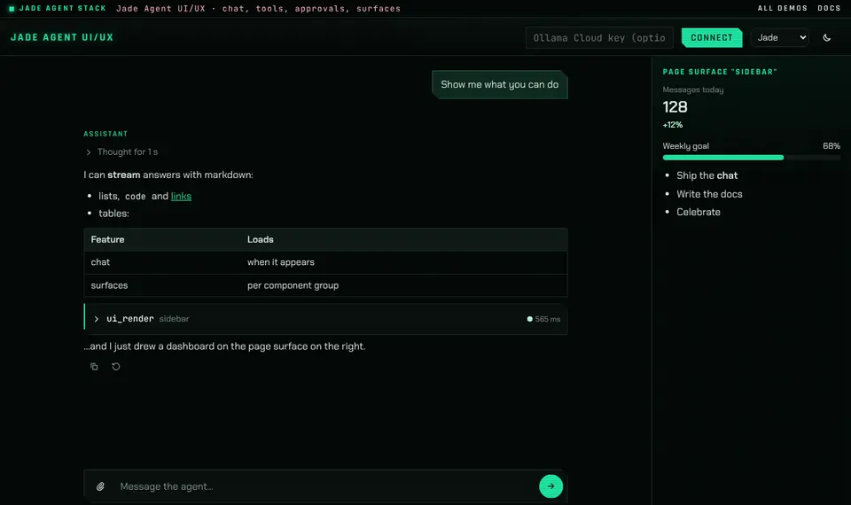 | 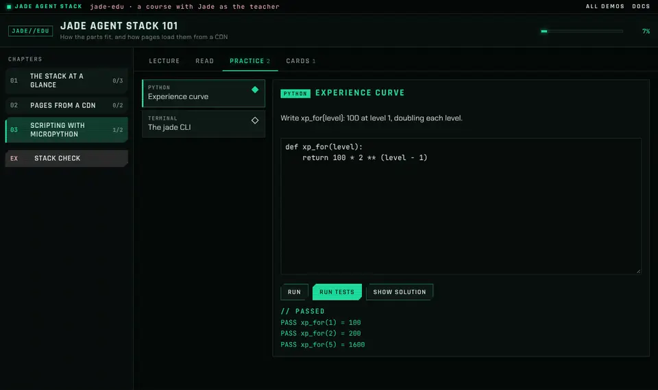 | 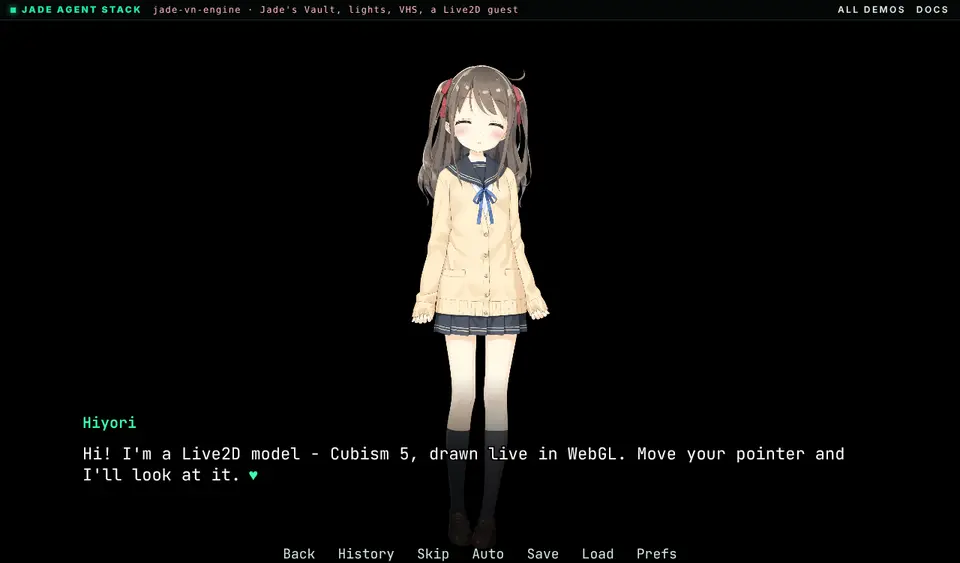 |
| **An RPG** | **Jade, the PNGtuber** | **A site from one YAML file** |
| 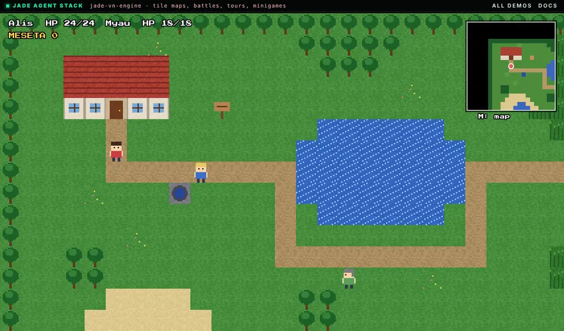 | 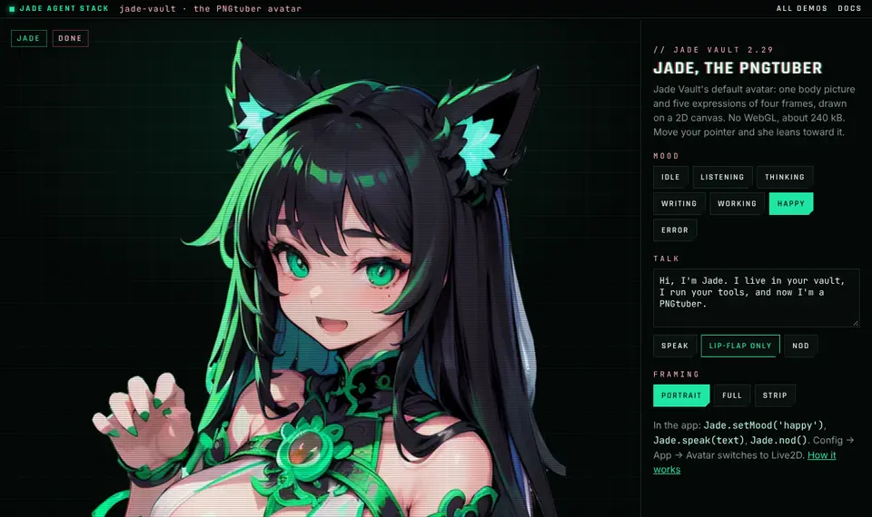 | 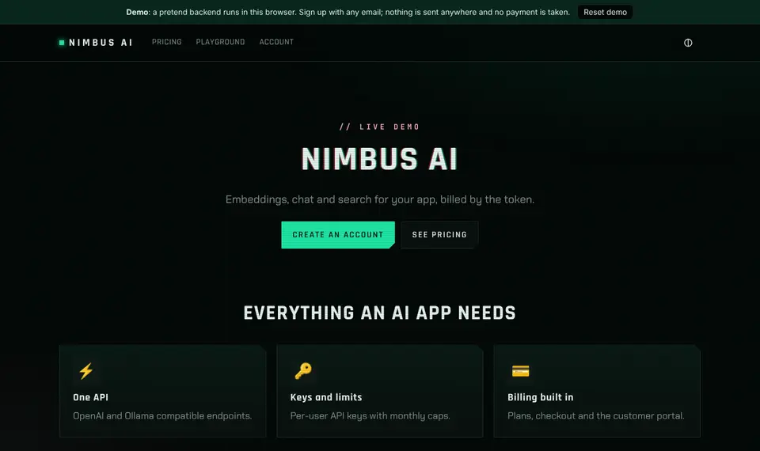 |

**Docs:** <https://lucky-edgelord.github.io/jade-agent-stack/> (people) · [`docs/md/`](docs/md/) and
[`llms.txt`](llms.txt) (agents) · `jade docs search <words>` (anyone, offline).

## Install

```sh
pip install jade-agent-stack              # Python 3.11+, needs only PyYAML
pip install "jade-agent-stack[keyring]"   # keep tokens in the OS keyring
```

## Sixty seconds

```sh
jade site new "Acme AI" --template saas --tagline "Embeddings for every app."
jade site build && jade site preview      # http://127.0.0.1:8080
jade init && jade doctor                  # connect a Jade Agent Base
jade site plan                            # every call a deploy makes; makes none
jade site deploy                          # collections, sign-in, models, plans, billing, then the pages
```

Eight templates (saas, chatbot, landing, waitlist, docs, portfolio, shop, dashboard), thirteen themes (Jade's Vault look by default), nineteen
sections. A settled design is saved once (`jade site template save house`) and reused (`template: house`).
See them built: [examples](https://lucky-edgelord.github.io/jade-agent-stack/examples/).

## Games and courses

Two more repositories hang off the same commands, so an agent can make a game or a course the way it makes a site.

```sh
jade vn new mygame --libs rpg,minigames    # game.toml + script.rpy (Ren'Py-style script, Python on MicroPython)
jade vn check mygame && jade vn build mygame     # a playable folder and a .xdc that runs offline in webxdc apps
jade edu new course.json --title "Intro to Jade"
jade edu validate course.json && jade edu page course.json page.html
```

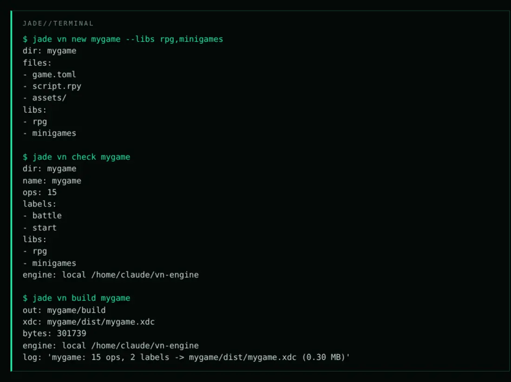

| The starter game, built by those commands | The starter course, played by `jade edu page` |
|---|---|
| 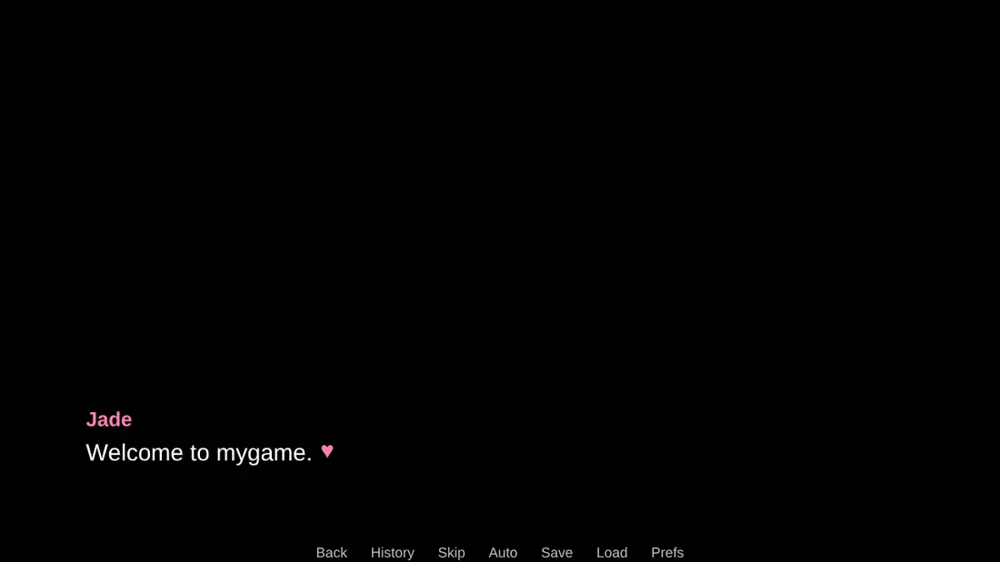 | 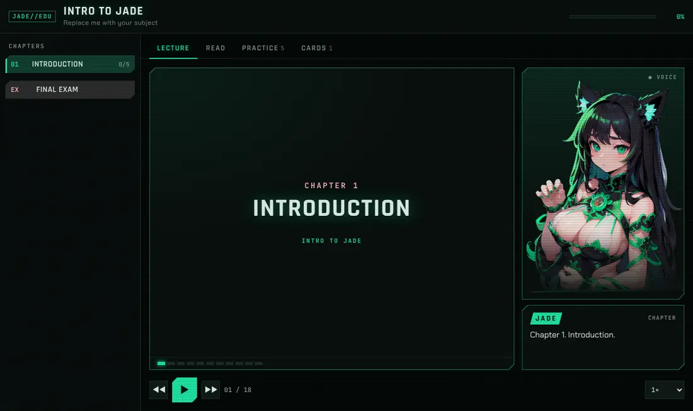 |

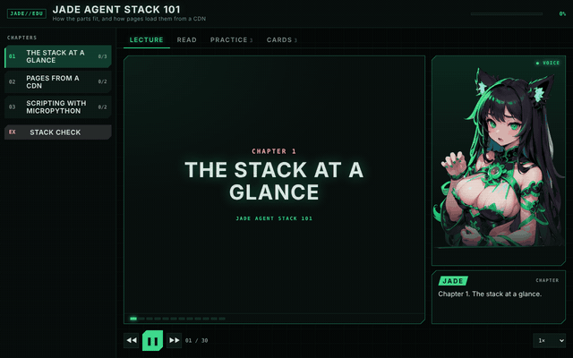

| A battle (jade-vn-engine) | A faux-3D tour | A terminal lab (jade-edu) |
|---|---|---|
| 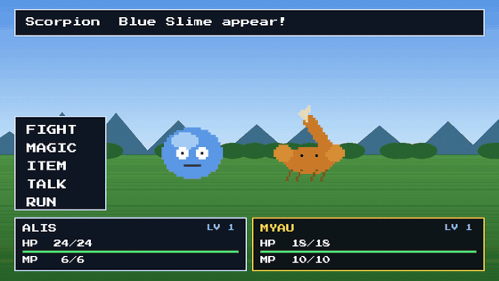 | 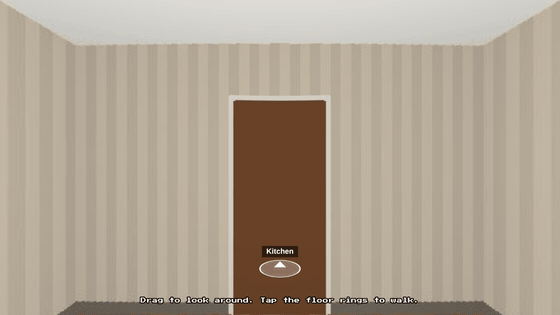 | 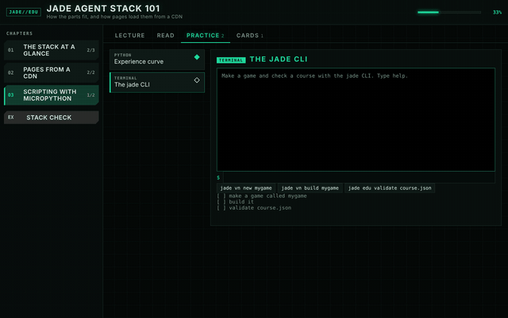 |

Both run at the commits pinned in [STACK.md](STACK.md) and come from the CDN, so nothing is installed on the page. Set
`JADE_VN_ENGINE` or `JADE_EDU` to use a local checkout. Over MCP the tools are `vn_new`, `vn_check`, `vn_build`,
`edu_new`, `edu_validate` and `edu_page`. Guides: [Games](https://lucky-edgelord.github.io/jade-agent-stack/games.html),
[Courses](https://lucky-edgelord.github.io/jade-agent-stack/courses.html). The images are made by `build/docshots.py`.

## Everything is a command, on every surface

| Surface | |
| --- | --- |
| CLI | `jade site build --json` (exit 0 ok, 1 user error, 2 remote error, 3 refused for safety) |
| REPL | `jade repl`; for programs `jade repl --jsonl` |
| MCP | `jade mcp` (tools `site_build`, `site_deploy`, `playbook_run`, `docs_search`, …) |
| HTTP | `jade serve` (127.0.0.1:9765; header-only token off loopback) |
| Python | `import jade; jade.Site(...).build("dist"); jade.Stack.load().run("doctor")` |

`jade commands` lists them all with their parameters, as data. Over MCP, HTTP and JSON lines an agent cannot widen its
own permissions: approvals, secrets and playbook approval need a person in a terminal.

## Safety

Header-only auth (a Vault that still accepts `?token=` is refused), secrets in the OS keyring and never in output,
scoped approvals where deny wins, idempotency keys on every mutation, short-lived task credentials per run, playbook
approvals bound to the file's hash, and a sandboxed expression language. See [Security](https://lucky-edgelord.github.io/jade-agent-stack/security.html).

## Develop

```sh
pip install -e .
python -m unittest discover -s tests      # end-to-end tests also need Go and ../jade-agent-base (and ../jade-agent-ui-ux for the browser test)
python build/build.py                     # docs, llms.txt, AGENTS.md, STACK.md, schema from src/jade/docs and the code
python build/build.py --check             # CI fails when they are stale
python build/demos.py && python build/demoshots.py   # rebuild the live demos, play them in Chrome, refresh thumbnails
python build/docshots.py                  # the README and docs screenshots (JADE_VN_ENGINE, JADE_EDU, Playwright, Chrome)
```

[STACK.md](STACK.md) (versions it works with) · [CONTRACT.md](CONTRACT.md) (Vault ↔ Base) · [DECISIONS.md](DECISIONS.md) · [AGENTS.md](AGENTS.md)

MIT
